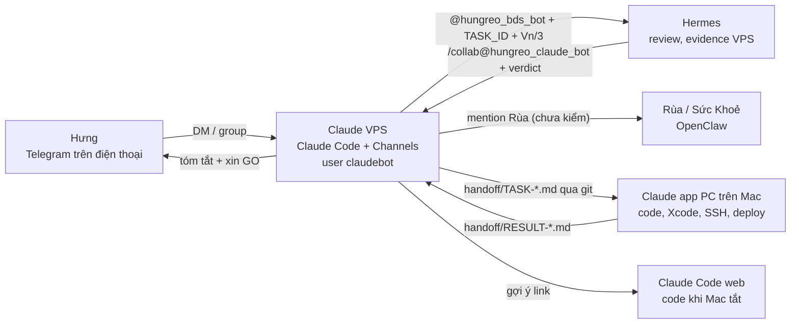

# TO-BE — Claude VPS làm Orchestrator (2026-11-25, bản nháp chờ Hưng duyệt)

> Gắn với `PLAN.md` (pha B, C). Vai trò quyết định quyền, nên chốt file này trước GO-B.

## 1. Một câu
Claude VPS là **lễ tân + điều phối 24/7**: nhận lệnh của Hưng qua Telegram, hiểu việc, chia việc, giao cho đúng người, theo dõi kết quả rồi báo lại. **Nó không tự tay vận hành** Rùa, Hermes hay VPS.

## 2. Sơ đồ

## 3. Ai làm gì

| Bên | Việc chính | Không làm |
|---|---|---|
| **Claude VPS** (orchestrator) | Nhận việc, hỏi lại cho rõ, chia task, viết TASK, gọi reviewer, theo dõi, tóm tắt, nhắc việc. Tự làm việc nhẹ trong sandbox: đọc docs/web, đọc repo (bản pull), viết plan và memo | SSH, deploy, đổi config bot khác, push code, gửi tin ra ngoài Telegram của Hưng |
| **Claude app PC** (Mac) | Implement, test, SSH VPS, deploy (có GO), việc cần Xcode, Keychain | Coi TASK file là GO |
| **Hermes** | Review độc lập, lấy evidence VPS read-only, phản biện plan | Thực thi thay Claude khi chưa được Hưng giao |
| **Rùa / Sức Khoẻ** | Việc nghiệp vụ hằng ngày của từng bot (tài chính, sức khoẻ…) | Nhận lệnh vận hành từ Claude VPS |
| **Claude Code web** | Code trên repo GitHub khi Mac tắt | (Hưng mở trực tiếp, Claude VPS chỉ gợi ý) |

## 4. Giao việc xuống bot khác được không? **Được, nhưng chỉ bằng "lời nhắn có địa chỉ"**

| Đường giao | Trạng thái | Ghi chú |
|---|---|---|
| Claude → Hermes trong group (mention `@hungreo_bds_bot` + TASK_ID + Vn/3) | **PRIOR-EVIDENCE**: đang chạy trên Mac (COLLAB_PROTOCOL, memory `bot-mention-trigger`) | Telegram chỉ đánh thức bot khác khi có mention đúng. Thiếu mention thì tin rơi |
| Hermes → Claude (`/collab@hungreo_claude_bot`) | PRIOR-EVIDENCE | Plugin chặn bot khác bấm duyệt quyền (`collab-gate.ts`), chỉ Hưng duyệt được |
| Claude → Rùa / Sức Khoẻ | **UNVERIFIED** | Chưa kiểm OpenClaw có nhận tin từ bot khác trong group không. Theo protocol hiện tại, Rùa chỉ tham gia khi Hưng giao. Đề xuất giữ vậy |
| Claude → app PC (`handoff/` qua git) | Thiết kế ở PLAN C1, C2 | App PC chỉ thấy khi phiên PC đang mở và pull. Không có "đánh thức" tự động |
| Claude → hàng đợi nội bộ VPS (vd `hungreo-suckhoe-handoff`) | **Không cấp** | Hàng đợi nằm trong `/home/hung`. Cấp vào là phá lớp cách ly |

Luật giao việc (giữ nguyên quy ước 3 vòng hiện có):
1. Mỗi việc có `TASK_ID`, người làm, tiêu chí đạt, số vòng tối đa.
2. Lời nhắn giữa các bot là **đề xuất**, không phải GO. Bot nhận vẫn theo quyền và luật của chính nó.
3. Việc ra ngoài (deploy, push, gửi tin, xoá, tiền, đổi config/model) chỉ chạy khi **Hưng GO trực tiếp** với bên thực thi.
4. Không retry gửi khi chưa rõ kết quả. Bên kia offline thì ghi trạng thái chờ rồi báo Hưng.

## 5. Quyền của Claude VPS (cấp gì, chặn gì)

| Nhóm | Cấp | Chặn (bằng gì) |
|---|---|---|
| Telegram | reply, react, edit, tải file đính kèm trong DM và group đã allowlist | Người lạ (allowlist), bot khác bấm duyệt (collab-gate) |
| File | Đọc+ghi `~/collab-bot` (memory, handoff, work). Đọc checkout `hungreo-openclaw` | `/home/hung` (quyền Unix, user riêng), `.env`, `~/.ssh` (deny + sandbox) |
| Lệnh | Bash trong sandbox bwrap: đọc, grep, script nhỏ, test | `sudo`, `docker` (không có group), `systemctl` của hung, `ssh`/`scp` |
| Mạng | WebFetch/WebSearch theo allowlist hiện tại | Host lạ phải hỏi; `curl`/`wget` phải hỏi |
| Git | **Không có key.** Timer `collabsync` push `handoff/`, `memory/` | Push code, đổi remote |
| Model | Subscription qua `setup-token` | `ANTHROPIC_API_KEY` (launcher fail-closed) |
| Subagent | Được dùng subagent nội bộ của Claude Code cho research/review | Không spawn phiên Claude khác ngoài quota |

## 6. "Mất đồ nghề" — bảng gọn

| Đồ nghề trên Mac | Trên VPS | Cách bù |
|---|---|---|
| Ổ chung với app PC | Mất | git `collab-bot` + `handoff/` (C1, C2) |
| SSH VPS, deploy | Cố ý không cấp | Giao app PC (có GO) |
| Xcode, iOS Simulator, Keychain | Mất hẳn | Chỉ app PC khi Mac bật |
| Voice whisper large (GPU) | Yếu hơn | faster-whisper-small, bật sau (B6) |
| Patch plugin (format, owner-gate, voice) | Phải port | Port 1 lần ở B2, ghi danh sách |
| Code khi Mac tắt | — | Claude Code web (C3, chưa kiểm gói) |
| **Được thêm** | Chạy 24/7, không phụ thuộc Mac ngủ/tắt | |

Đồ nghề mất nhiều, nhưng phần lớn là **cố ý không cấp**, để bot đứng cạnh production mà không chạm được production. Thứ thật sự mất là Xcode/Keychain và ổ đĩa chung.

## 6b. Toolkit chính thức của Anthropic — chọn gì (tra docs 25/11)

Hưng chốt 25/11: chưa cho giao việc thẳng xuống Rùa; chỉ tập trung đưa bot lên VPS.

| Toolkit | Dùng cho bot? | Lý do (docs) |
|---|---|---|
| **Claude Code CLI + Channels (plugin Telegram)** | ✅ **Chọn** | Đang chạy trên Mac. Docs cho phép user tự đăng nhập "unmodified Claude Code binary" bằng subscription của mình (legal-and-compliance). Channels vẫn là research preview, cần Bun, và chỉ nhận tin khi phiên đang mở |
| Agent SDK (Python/TS) | ❌ Không | Docs khuyên dùng API key. Dùng claude.ai login cho agent tự build là vùng xám, tốn công viết lại harness |
| Managed Agents (Claude API) | ❌ Không | Tính tiền API theo token, đúng loại rủi ro sự cố 08/05 |
| Headless `-p` / `--bare` | ❌ Không làm bot | `--bare` không đọc OAuth, chỉ nhận API key. `-p` tắt tool cần terminal |
| **Remote Control** | ⚠️ Tuỳ chọn | Cho Hưng mở phiên bot VPS từ app Claude trên điện thoại. **Không chạy với `setup-token`** ("only make model requests"), phải `claude auth login` thật trên VPS. Đổi lại phải chặn bot đọc file credentials |
| Routines / Claude Code web | ✅ Bổ sung | Chạy trên cloud Anthropic, dùng cho code hoặc lịch khi Mac tắt. Không thay bot Telegram |

- `setup-token` + Channels: docs không nói rõ, nhưng **PRIOR-EVIDENCE**: bot Mac đang chạy đúng tổ hợp này từ 17/11.
- Docs có nhắc `--dangerously-skip-permissions` cho chạy không người trông. **Không dùng**: giữ `auto` + duyệt qua DM như Mac.

Nguồn: code.claude.com/docs/en/{channels,authentication,agent-sdk/overview,headless,remote-control,legal-and-compliance}.md

## 7. Còn cần kiểm trước GO-B
- [ ] Rùa có nhận tin bot khác trong group không (nếu Hưng muốn Claude giao việc cho Rùa).
- [ ] Mention Hermes vẫn chạy khi Claude đổi sang token bot test (B4b), vì username bot test khác `hungreo_claude_bot`.
- [ ] Group allowlist (`access.json`) đúng chat id khi chép sang VPS.
- [ ] App PC có cách được "đánh thức" khi có TASK mới (hiện chưa có, Hưng mở phiên PC thì mới pull).
